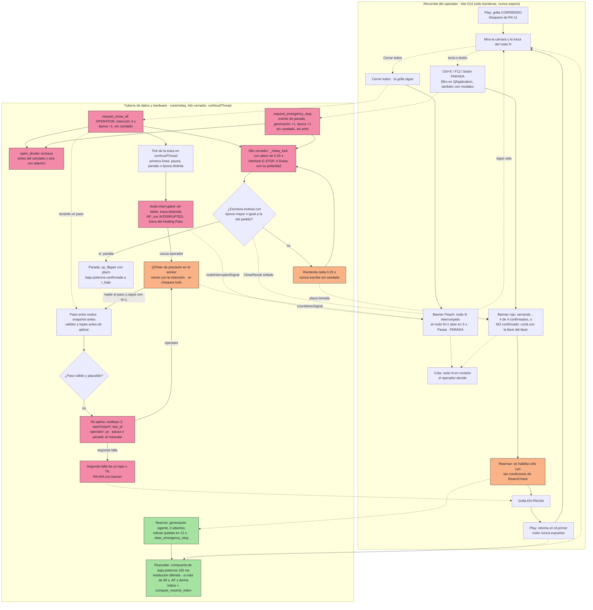

# C-01 / R4-17 — Ronda 2 — Panel de arquitectura de software (`software-architect`)

Estado: COMPLETO (2026-10-02). Ronda de diseño: no se modificó código ni tests y no se ejecutó nada
contra hardware. Único archivo escrito: este. Árbol: `main` @ `927e818` (incluye el arreglo de la
Pausa de `DEC-041`, `43d8034`).

**Qué leí.** `CLAUDE.md` §4-§5; `c01_ronda4/SINTESIS_RONDA1.md`, `instrumentation.md`,
`devil_advocate.md`, `experimentalist.md`; `c01_ronda3/gui_design_v2.md` §5, §6, §9 y §11, y
`qa_ux_audit.md` §7 (N-1 a N-11, filas R4-25 a R4-31); `RESPUESTAS_INVESTIGADOR.md`, "C-01, Ronda 4 —
mini Ronda 1"; `DEC-036`, `DEC-037`, `DEC-041`; `PRUEBAS_BANCO_PENDIENTES.md` (BANCO-65 a BANCO-70);
`.claude/agents/exemplars/pyqt_routine_concurrency_gold.md`. Código, orientado con `graphify
query/explain` (el MCP de graphify no conectó; usé el CLI). **El grafo está desactualizado**: sus
líneas son anteriores a `DEC-041`, así que cada línea citada acá la verifiqué en el fuente de
`927e818`. Leí `app.py`, `core/nidaq.py`, `core/shutters.py`, `modules/measurements.py`,
`modules/trace.py`, `modules/focus.py`, `modules/confocal.py`, `config.py` (`_stage_fault`),
`pyspectrum/window.py`, `pyspectrum/modules/hardware_session.py`,
`tests/test_grid_pause_halts_chain.py`, y del legado `printing2/PyPrinting_UNSAM.py`.

**Marcas.** **[CÓDIGO]** archivo:línea en `927e818` · **[LEGADO]** `printing2/` · **[INV-R4]**
decisión vinculante de la mini Ronda 1 (2026-10-01), numerada como en el encargo · **[INS]**, **[DA]**,
**[EXP]**, **[GUI]**, **[QA]** las notas del panel · **[INFERIDO]** razonamiento no probado ·
**[BANCO]** se resuelve en el banco.

---

## Resumen ejecutivo

1. **Topología: la cadena de la grilla pasa entera a `confocalThread`.** Se quitan los dos
   despachadores que hoy corren en el hilo GUI (`app.py:487-490`, el cierre `_on_autofinish`, y
   `app.py:499, 556-564`, `_dispatch_trace`). Tres razones:
   - el disparador de la parada vive en el hilo GUI, que hoy ejecuta ≈ 1.2 s de `sleep` por nodo
     **justo antes de abrir a alta potencia**;
   - el legado corría toda la cadena en **un solo hilo** con conexiones directas
     ([LEGADO] `PyPrinting_UNSAM.py:416-427`, con los `moveToThread` comentados en `:470-481`);
   - con el criterio en otro hilo que la traza, un tick encolado después de la decisión puede
     producir una **segunda decisión** sobre el mismo nodo [INFERIDO, §2 H8].

   La protección por eventos de `DEC-041` se conserva como segunda barrera. No se toca la lectura
   por tick de `DEC-037`.
2. **Una sola fuente de verdad sobre los cortes, en `core/nidaq.py` y sin Qt:**
   - una **época de cierre** monótona, con su causa;
   - un **evento de parada** con generación, que `open_shutter` revisa **antes** del candado y otra
     vez adentro;
   - una **retención de apertura de 3 s** para "Cerrar todos" con una rutina corriendo;
   - un **hilo cerrador** con `_nidaq_lock.acquire(timeout = 0.25 s)` que no se rinde;
   - una **compuerta de baja potencia** de ≥ 100 ms.

   Arriba de eso, `core/emergency_stop.py` (coordinador único por proceso, sin Qt) y
   `core/ui/emergency_keys.py` (filtro de teclas y puente Qt).
3. **Dos máquinas de estado explícitas** en `core/grid_state.py`, sin Qt y testeables solas:
   - la de la grilla: `IDLE / RUNNING / PAUSED / STOPPED / FINISHED`;
   - la del nodo: `"interrupted"` es "expuesto sin decisión" y va a revisión; el índice de
     reanudación se **calcula**, nunca se toma de `i_global`.
4. **Siete fases**, cada una con su test que falla primero:
   - la 0 es exenta (sólo tests);
   - el orden va del arreglo más chico y más seguro al de más superficie: la verdad de "Cerrar
     Todos", la topología, la época, la parada, los pasos entre nodos y la confirmación;
   - la confirmación entra **apagada** hasta BANCO-65.
5. **Verificación:**
   - un banco de pruebas de cadena real (Qt con hilos, `nidaqmx` y PI falsos, registro de cada
     escritura DO con hilo y causa);
   - un **test dorado de `legacy_timer`** grabado **antes** de la fase 1;
   - la matriz **6 cortes × 7 etapas** del abogado del diablo, que se va encendiendo fase por fase;
   - 18 mutaciones con su test que las mata.
6. **Cinco preguntas** para el investigador (§13). La más importante: si la Pausa sigue la misma
   regla de reanudación que el rearme. Hoy `DEC-041` y `gui_design_v2.md` §6.7 dicen otra cosa.

**Veredicto:**
- **código actual: `CONCURRENCY_RISK`**. La cadena está repartida en dos hilos; el hilo GUI duerme
  antes de abrir; las señales de control viejas llegan tarde y sin guarda en el criterio.
- **diseño de este documento: `CLEAN_ARCHITECTURE`**, condicionado a la fase 0 (línea de base dorada
  grabada antes de tocar nada) y a BANCO-66, 67, 68 y 70.

---

## 1. Síntesis ejecutiva de lo acordado

| # | Decisión vinculante [INV-R4] | Dónde la toma este diseño |
|---|---|---|
| 1 | Parada propia: grilla DETENIDA; Rearmar y Play son dos acciones; una sola parada por proceso en satélite; `Ctrl+E` / `F12` con un filtro en `QApplication` | §4.2-§4.5; `GridRunState.STOPPED`; `EmergencyCoordinator` singleton; `EmergencyKeyFilter` |
| 2 | Si el cerrador no consigue la placa: banner persistente "cortá con la llave del láser" y reintentos, sin escritura sin candado | §4.1.4: el cerrador reintenta cada 0.25 s mientras haya una solicitud pendiente; no existe una ruta sin candado |
| 3 | Después del cierre confirmado, el filtro sube; ≈ 100 ms antes de cualquier autofoco o movimiento posterior | §4.1.6 `LOW_POWER_SETTLE_S = 0.10`: es un **piso**, no reemplaza las esperas de 0.5-1 s de hoy |
| 4 | Se retoma desde el primer nodo nunca expuesto; el interrumpido va a revisión; si la parada duró > 60 s, autofoco y deriva antes | §4.6 `compute_resume_index`; `RESUME_REFOCUS_AFTER_S = 60.0` |
| 5 | "Cerrar todos" no pausa, ni siquiera dos veces; el nodo queda "expuesto sin decisión", a revisión (el Healing Pass no lo toma); la grilla sigue después de 3 s visibles, que no son un `sleep` | §4.1.3 (retención), §4.5 (`QTimer` del worker), §4.6 (`"interrupted"` fuera del Healing Pass) |
| 6 | Pasos entre nodos: con un corte no se aplica la corrección, se restituye Z, `startX/startY` y `last_af_*`, y se repite; topes provisorios; si falla dos veces, **pausa** | §4.7 `StepSnapshot`, `core/step_plausibility.py` |
| 7 | Confirmación a baja potencia **sin BS**; diferida para los nodos que cortó el operador; "no sé" → revisión | §4.8, fase 6 apagada hasta BANCO-65 |
| 8 | El láser no tiene interlock remoto. PySpectrum legacy y PyPrinting 3.0 no corren a la vez durante una grilla | §11 R-14: el software no lo puede imponer; va al manual y al banner |

**Corrección al encargo:** BANCO-69 **no existe** como ítem activo. Era la prueba del BS, que quedó
en suspenso (`docs/PERSPECTIVAS.md:115`). Los ítems de banco vigentes de esta ronda son BANCO-65,
BANCO-66, BANCO-67, BANCO-68 y BANCO-70.

---

## 2. Hechos del código que condicionan el diseño

Agrego a la tabla H1-H14 de [INS] §0 lo que cambia con `DEC-041` y lo que encontré en esta lectura.

| # | Hecho | Evidencia |
|---|---|---|
| H1 | `app.Backend` **no** se mueve de hilo: vive en el hilo GUI. Los workers de impresión, dímeros, foco, traza y confocal están en `confocalThread` | [CÓDIGO] `app.py:702-735` (no hay `moveToThread(worker)`) |
| H2 | El fin del autofoco llega al hilo GUI por un cierre (`_on_autofinish`) | [CÓDIGO] `app.py:487-490` |
| H3 | El criterio corre en el hilo GUI: `data_printingSignal` → `app.Backend._dispatch_trace` → `grid_trace_detect` | [CÓDIGO] `app.py:499, 556-564` |
| H4 | Desde el hilo GUI, `grid_trace_stopSignal` → `traceWorker.stop` y `grid_detectSignal` → `grid_scan` son **encoladas** a `confocalThread`. Si la cadena pasa a un solo hilo, en `AutoConnection` serían directas | [CÓDIGO] `app.py:508-509` |
| H5 | **El legado corría todo en el hilo GUI, con conexiones directas.** El `moveToThread` de cada worker está comentado, y el criterio está conectado al slot del worker | [LEGADO] `PyPrinting_UNSAM.py:416-427, 470-481` |
| H6 | `DEC-041`: `is_paused` es un `threading.Event`; `_halted()` está en cada entrada salvo `grid_trace_detect`; `_detect_pending` define la reanudación | [CÓDIGO] `measurements.py:1567-1595, 2006-2024, 2498` |
| H7 | **`grid_trace_detect` no mira la pausa.** Una Pausa durante la exposición llega por `request_pause`, pero el tick siguiente evalúa sobre oscuridad. La rama de caída (`umbral_down`) o T_max lo rotulan `"timeout"`, y el Healing Pass lo reexpone. Es la misma falla que N-4, pero con la Pausa | [CÓDIGO] `measurements.py:2384-2392, 2467-2477, 2899` |
| H8 | **Sin guarda de reentrada ni de sesión en el criterio.** La decisión se toma en el hilo GUI y la traza se detiene después, por una señal encolada. Un tick que `confocalThread` emitió mientras tanto llega al hilo GUI **después** de la decisión: puede decidir otra vez y emitir un segundo `grid_detectSignal`, que avanzaría `i_global` dos veces y movería la platina con el nodo siguiente abierto. Ya estaba en la lista pendiente de `DEC-037` ("a re-entrancy guard on `grid_trace_detect`"). La frecuencia depende de cuánto dura cada tick | [CÓDIGO] `measurements.py:2467-2499`, `trace.py:738-740`; [INFERIDO]. La fase 0 lo mide (§9.1, sonda P-1) |
| H9 | `open_shutter`, `close_shutter` y `close_all_shutters` hacen `print()` **dentro** de `_nidaq_lock`: rechazo por interlock, error y simulador. En la consola de Windows, un `print` bloquea mientras la consola está en modo selección (QuickEdit). Un operador que hizo clic en la terminal puede dejar el candado tomado | [CÓDIGO] `nidaq.py:469, 483, 486, 524, 561`; [INFERIDO] (comportamiento conocido de la consola); se verifica en BANCO-68 |
| H10 | La fila ✅ de la parada en `lab-invariants` §4 apunta a `pyspectrum/window.py::_setup_shortcuts`, y `tests/test_prompt_corpus_integrity.py` la verifica | `.claude/shared/lab-invariants.md:168`; `test_prompt_corpus_integrity.py:322` |
| H11 | La E-STOP de PySpectrum abre un `QMessageBox.critical` modal desde dentro del filtro de teclas, y `emergency_stop()` toma el `RLock` de sesión y llama a la cámara en el hilo GUI | [CÓDIGO] `window.py:459-481`, `hardware_session.py:150-208` |
| H12 | `TRACE_ACQ_BACKEND` **no existe** en el código. "`legacy_timer`" es el nombre del camino actual de `DEC-037`, que hoy es el único | `grep` sin resultados fuera de `docs/` |
| H13 | Sólo las rutas de falla llaman a `close_all_shutters()`, nunca el flujo normal de la grilla: `_moveto`, `_grid_move`, `_check_physical_connection_or_pause`, `_move_z`, aborto del confocal, tareas de fotodiodos, watchdog, excepthook, `atexit`, platina | [CÓDIGO] `measurements.py:1825, 2146, 2196`; `focus.py:490`; `confocal.py:994, 1209`; `nidaq.py:187, 308, 330, 870`; `config.py:260-262` |

H13 importa porque permite que la época de cierre la incremente **todo** `close_all_shutters()` sin
alterar una grilla sana: la línea de base dorada no tiene ningún cierre total en el flujo normal.

---

## 3. Topología de hilos

### 3.1 Opciones

| | T-A. Dejar la topología y protegerla con eventos | T-B. Sólo el fin del autofoco al worker (la propuesta mínima de [INS] §1.6) | **T-C. Toda la cadena en `confocalThread`** (recomendada) |
|---|---|---|---|
| Qué cambia | nada en `app.py`; guardas dobles (antes y después de cada `sleep`) en cada etapa que corre en el hilo GUI | `autofinishSignal` → slot del worker; el criterio sigue en el hilo GUI | los dos despachadores pasan a slots de `MeasBackend` en `confocalThread`; conexiones explícitas (§3.3) |
| `sleep` en el hilo GUI por nodo | ≈ 1.2 s antes de abrir (H7 de [INS]) | 0 antes de abrir. En la decisión quedan `_save_trace` y HDF5, después del cierre | 0 |
| Latencia de la parada con la grilla corriendo | + hasta ≈ 1.2 s (`TIMING_HAZARD`) | la del filtro de teclas (≤ ms), con la GUI libre | ídem |
| Tick tardío después de la decisión (H8) | hace falta un token de sesión en el payload y en `grid_traceSignal` | ídem | **no ocurre**: el `stop` corre en el mismo hilo y **antes** del tick siguiente |
| "Cerrar todos" contra el criterio | mismo hilo (determinista) | mismo hilo | hilos distintos: lo resuelve la época, que de todos modos es entre hilos |
| Retraso del criterio por carga de la GUI (cámara en vivo, gráficos) | sigue (también en `7f5d10a`) | sigue | **desaparece**: el criterio corre dentro del tick |
| Parecido al legado | bajo | medio | **alto**: un hilo, criterio dentro del tick (H5) |
| Superficie del cambio | muchas guardas, cada una con dos hilos posibles | dos líneas | cuatro conexiones y dos slots nuevos |
| Riesgo sobre `DEC-037` | ninguno en el criterio | ninguno en el criterio | el criterio cambia de hilo, con la misma función y los mismos datos (§3.2) |

### 3.2 Riesgos de regresión de T-C, y cómo se controlan

**Sobre `legacy_timer` (`DEC-037`).**
- **La lectura por tick no cambia.** `_trace_update` sigue creando y cerrando una tarea finita por
  tick (`trace.py:641-740`). Lo único que cambia es quién consume el payload y en qué hilo.
- **El criterio es la misma función con los mismos argumentos**, así que la decisión sobre la misma
  secuencia de datos es la misma por construcción. Lo cambia el *momento*: hoy la decisión espera la
  cola del hilo GUI, y con T-C ocurre dentro del tick. El obturador cierra igual o antes, nunca
  después.
- **Lo que cuesta, en el tick de la decisión:** `_save_trace` y la escritura HDF5 pasan a
  `confocalThread`.
  - Ocurren **después** del cierre, así que no alargan ninguna exposición.
  - Retrasan el arranque del nodo siguiente lo mismo que hoy: hoy el hilo GUI guarda y recién
    después emite `grid_detectSignal`.
- **Cadencia de los ticks.** El trabajo del criterio por tick es trivial: las medias ya vienen en el
  payload, `trace.py:713-724`. La cadencia medida (≈ 47 ms) no debería moverse. El test dorado
  registra el índice de tick de cada decisión, y BANCO-70 vuelve a medir Δt.
- **La línea de base de BANCO-32** ([DA] §6) todavía no tiene datos. T-C la acerca al legado, no la
  aleja.

**Sobre lo que funciona en `7f5d10a`.**
- La PC del banco imprime con `7f5d10a`, que tiene la cadena repartida como hoy ([DA] §6). Que
  imprima bien **no** depende de que el criterio corra en el hilo GUI. La parte que hace funcionar la
  impresión es la lectura fresca por tick (`DEC-037`), y esa no se toca.
- El cambio de hilo **sí** altera el orden entre etapas. Por eso la fase 2 no mezcla lógica: sólo
  cambia las conexiones, y pasa el test dorado (decisiones idénticas nodo a nodo y log DO idéntico)
  antes de que entre la época.
- BANCO-70 (la Pausa en cada etapa) se corre **después** de la fase 2. Si se corre antes, valida una
  topología que va a dejar de existir.

**Riesgos propios de un solo hilo, y su control.**
1. **Pila anidada.** Con conexiones directas en un mismo hilo, la decisión llama a `grid_scan` y de
   ahí a todo el nodo siguiente (movimiento, autofoco de ≈ 2 s, apertura) **dentro** del manejador del
   tick del nodo anterior. El legado lo hacía así (H5) y funcionó años, pero los slots de control
   encolados (`grid_pause`, `stop_scan`) esperan a que termine la pila.
   - Control: toda frontera entre etapas que **hoy** cruza hilos pasa a `QueuedConnection` explícita.
     Así se conserva la semántica de 3.0 de que "cada etapa empieza en una vuelta nueva del bucle de
     eventos".
2. **Las señales del worker hacia la GUI** (`nodeStatusSignal`, `timeRemainingSignal`,
   `driftZDisplacementSignal`) pasan de directas a encoladas. Ningún slot de la GUI depende de
   ejecutarse en el acto: se verifica con el test de hilos de la fase 2.
3. **El `stop` de la traza tiene que seguir siendo sincrónico.** Si alguien moviera después la traza
   a otro hilo, una `DirectConnection` explícita llamaría entre hilos.
   - Control: `AutoConnection`, que se resuelve como directa cuando los dos están en el mismo hilo, y
     un test que **afirma** que todas las etapas corren en `confocalThread`.
4. **Los `sleep` de la cadena** (0.1 s a 1 s) bloquean ahora `confocalThread` y no el hilo GUI.
   - Ahí no corre nada más durante la cadena: es secuencial.
   - Las órdenes de control no esperan esos `sleep`: llegan como banderas entre hilos (la Pausa de
     `DEC-041`, la parada de §4.1) y no como slots encolados.

### 3.3 Conexiones: antes y después

| Señal | Hoy | Después (fase 2) |
|---|---|---|
| `focusWorker.autofinishSignal(str)` | → cierre `_on_autofinish` en el hilo GUI → `grid_finish_autofoco()` | se conserva para otros oyentes. **Nueva** `focusWorker.autofocusFinished(str, object)` → `MeasBackend.on_autofocus_finished(str, object)`, en **`QueuedConnection`**; cada worker filtra por `mode_arg`. En la fase 2 el `object` es `None`; en la fase 5 es un `AutofocusResult` |
| `traceWorker.data_printingSignal(list)` | → `app.Backend._dispatch_trace` (hilo GUI) → `grid_trace_detect(payload)` | → `MeasBackend.on_trace_data(list)`, en `AutoConnection` (directa en el mismo hilo). Filtra `data[-1] == self.mode_arg` y llama a `grid_trace_detect(data[:-1])`. **Se borran** `_dispatch_trace` y el cierre |
| `grid_trace_stopSignal` → `traceWorker.stop` | encolada (se emite desde el hilo GUI) | `AutoConnection`: directa y sincrónica |
| `grid_detectSignal` → `grid_scan` (y `→ grid_finish` en dímeros) | encolada | **`QueuedConnection` explícita** (frontera de etapa) |
| `traceWorker.traceAbortedSignal(str, str)` (**nueva**, fase 4) | — | → `MeasBackend.on_trace_aborted(mode, cause)`, `AutoConnection` |
| `printingWorker.nodeInterruptedSignal(int, str, float)`, `countdownSignal(int, float)`, `runStateChanged(str)`, `stepRejectedSignal(int, str, str)` (**nuevas**) | — | → Frontend, encoladas |

El resto de las conexiones de `confocalThread` que hoy ya son del mismo hilo **no se tocan**: por
ejemplo `grid_move_finishSignal` → `grid_autofoco`, `grid_autofocusSignal` →
`focus_autocorr_lin_x2` y `scanfinishedSignal` → `on_scan_finished`.

### 3.4 Ejemplar dorado de concurrencia

Lo apliqué (`pyqt_routine_concurrency_gold.md`):
- **Paso más largo:** el autofoco de la grilla, ≈ 1.5-2 s ([EXP] H5), más `_move_z` con plazo de
  10 s. Supera de lejos "unos pocos ms", así que **no** puede vivir en el hilo GUI. Es el criterio del
  ejemplar, y T-C lo cumple.
- **La trampa del `QThread` real:** un worker bloqueado no recibe señales. Por eso la parada, la
  Pausa y el "Cerrar todos" **nunca** se entregan como slots: son banderas o eventos que se consultan
  entre subpasos (`_halted()`, `is_emergency_stopped()`, la época), y la apertura misma las consulta
  (§4.1.2).
- **Intervalo máximo entre consultas:** ≤ 1 tick de la traza (≈ 47 ms); entre las dos rampas del
  autofoco y antes de cada `_move_z`; en cada píxel o rampa del confocal.

---

## 4. Componentes

### 4.1 `core/nidaq.py`: la fuente única de los cortes (sin Qt)

#### 4.1.1 Época de cierre

- **Estado:** `_close_epoch: CloseEpoch`, una tupla inmutable que se **reemplaza** entera.
  - Los lectores la leen sin candado: la asignación de una referencia es atómica.
  - Los escritores se serializan con `_epoch_lock`, un `threading.Lock` propio. Nunca se toma junto
    con `_nidaq_lock` ni se retiene durante una E/S.
- **Quién la incrementa:** `request_close_all`, `request_emergency_stop` y `close_all_shutters(cause)`.
  Se incrementa **al pedir** el cierre, **antes** de tomar `_nidaq_lock`. Así el consumidor ve la
  interrupción aunque el cerrador siga esperando el candado ([INS] §3.2).
- **Por qué una época y no una bandera** ([INS] §3.2, [DA] §6):
  - es monótona y no hay que limpiarla, así que no tiene dueño;
  - cada consumidor compara contra el valor que anotó;
  - con eso no hay "bandera rancia" que deje en cascada nodos en revisión (E-12).
- **Causas:** `CloseCause` (§5.1). La política de qué le pasa a la grilla con cada causa está en
  `core/grid_state.py::CAUSE_POLICY` (§4.6), no en `nidaq`.

#### 4.1.2 Evento de parada y orden seguro

- **`request_emergency_stop(source)`**, en el hilo GUI, **sin candado y en < 1 ms**, en este orden:
  1. `_estop_event.set()` (es el interlock funcional, [DA] F-4);
  2. `_estop_generation += 1`;
  3. época + 1 con causa `ESTOP`;
  4. anota la hora (monotónica y de pared);
  5. despierta al cerrador.

  No hace `print` (H9) ni abre diálogos.
- **`open_shutter`:**
  - revisa `_estop_event` y la retención (§4.1.3) **antes** de pedir el candado: si hay alguno,
    rechaza sin escribir y avisa **después**, fuera del candado;
  - **los vuelve a revisar adentro**, junto a `_shutter_interlocks`;
  - una apertura que ya estaba escribiendo termina (< 1 ms) y el cerrador la deshace enseguida
    ([INS] §5.3).
- **El orden es el seguro:** primero el interlock y después el cierre, como `trip_shutter_interlock`
  (`nidaq.py:305-308`). Se invierte el de `gui_design_v2.md` §5.1 ([DA] S2).
- **`heartbeat_shutter()` no hace nada mientras `_estop_event` esté puesto** ([INS] §5.2).
  - Es un cambio de política del watchdog, nunca exento; entra en esta deliberación.
  - **No se toca** el `heartbeat_shutter(30.0)` explícito de `trace.py:589, 644` ni el de
    `focus.py:380` (C-29, §12).

#### 4.1.3 Retención de apertura de "Cerrar todos" (la espera de 3 s como barrera)

- **Qué es:** `request_close_all(OPERATOR, hold_s = 3.0)` fija `_open_hold_until = monotonic() + 3.0`.
  Si ya había una retención, la extiende y toma el máximo.
- **Qué hace:** `open_shutter` rechaza toda apertura mientras dure, de cualquier rutina y por
  cualquier camino.
- **Cuándo se pide:** sólo cuando hay una rutina corriendo (el coordinador lo sabe, §4.2). Sin rutina,
  "Cerrar todos" cierra y no retiene.
- **Por qué además de la cuenta regresiva de la grilla:** cubre lo que no pasa por las guardas de la
  grilla. Por ejemplo, la segunda apertura de `trace._start` (H11 de [INS]), el cierre que cae en el
  `sleep(0.5)` previo a abrir (E-5) y cualquier ruta que un cambio futuro agregue. Es la propuesta
  §2.3-1 de [DA], hecha **sin** `_nidaq_lock`.
- **La cuenta regresiva y la barrera son el mismo plazo.**
  - El worker programa su continuación con `get_open_hold_remaining_s()`, en un `QTimer` de tipo
    `PreciseTimer`, más 20 ms.
  - Si al dispararse todavía queda retención, se reprograma. Así un `QTimer` impreciso
    (`CoarseTimer` ± 5 %) no puede adelantarse y fabricar un "apertura rechazada" en bucle.

#### 4.1.4 Hilo cerrador (`_ShutterCloser`, uno por proceso, de larga vida)

- **Arranque:** al importar el módulo, como el watchdog, en un hilo demonio (`daemon`) con nombre
  `"ShutterCloser"`.
- **Trabajo pendiente:** "que exista una escritura exitosa de las cuatro líneas cerradas con época
  ≥ `_pending_epoch`".
  - `_last_written_epoch` lo actualizan el cerrador **y** cualquier `close_all_shutters` sincrónico
    que escriba bien (watchdog, falla de platina).
  - El cerrador termina cuando `_last_written_epoch ≥ _pending_epoch`. Junta todos los pedidos que
    llegaron mientras tanto (paradas repetidas, [DA] F-8).
- **Bucle:**
  1. `_nidaq_lock.acquire(timeout = ESTOP_LOCK_TIMEOUT_S)`.
  2. Con el candado:
     - si hay parada, `_shutter_interlocks[ESTOP_INTERLOCK] = …`; es cosmético, porque el interlock
       funcional es el evento;
     - después, el cierre de las cuatro líneas, cada una con su polaridad (el 532 en ALTO), con los
       3 intentos de hoy. El cuerpo de `close_all_shutters` se extrae a `_close_all_locked()`, que
       comparten los dos caminos.
  3. Suelta el candado.
  4. Sella un `CloseResult` con la época y la generación vigentes y lo entrega a los oyentes **fuera
     del candado**.
- **Si no consigue el candado:**
  - sella un `CloseResult(ok = False, error = "placa tomada por otro hilo")`, una vez por episodio
    (eso enciende el banner de [INV-R4] 2);
  - reintenta cada `ESTOP_RETRY_INTERVAL_S` **mientras quede trabajo pendiente**. Nunca se rinde y
    nunca escribe sin candado.
- **Después de un cierre confirmado de una parada:** `up_flipper(lock_timeout_s = 0.25)` ([INV-R4]
  3).
  - Si el filtro no confirma, se informa, pero **no** cambia el resultado de la parada.
  - La compuerta de §4.1.6 vuelve a intentarlo al reanudar.
- **No toca** el espejo de detección, `ao2` ni la platina ([INS] §1.2 paso 8, §1.4).
- **Orden de candados:** el cerrador sólo toma `_nidaq_lock`, y `_epoch_lock` nunca se anida con él.
  No hay abrazo mortal con `_PIController._lock` → `_nidaq_lock` ([INS] §5.4).

#### 4.1.5 "Confirmado" deja de poder mentir

Es el hallazgo 4 de [DA] y la S5.
- **`close_all_shutters` con falla:** marca como **sin confirmar las cuatro líneas**, no sólo las que
  el software creía abiertas (`nidaq.py:553-560`). Una escritura fallida no permite asegurar ninguna
  línea: con la placa reiniciada y la línea sin manejar, el 532 queda abierto (BANCO-16).
- **Consecuencias:** `_all_closed_confirmed()` ya no da verdadero sin una escritura exitosa;
  `get_open_shutter_names()` las lista; el watchdog reintenta.
- **Para la parada,** "confirmado" es exactamente `CloseResult.ok` de una escritura con
  `epoch ≥ epoch_de_la_parada` ([INS] §1.2). Nunca es `_all_closed_confirmed()`.

#### 4.1.6 Compuerta de baja potencia

- **Estado:** `_low_power_confirmed_at: float | None`, la hora monotónica del último `up_flipper` que
  la placa confirmó. Se pone en `None` con un `down_flipper` confirmado o con una falla.
- **`low_power_settle_remaining_s(min_settle_s = LOW_POWER_SETTLE_S) -> float | None`:**
  - `None` si no hay baja potencia confirmada;
  - si no, lo que falta para cumplir el piso de 100 ms.
- **Quién la usa:** la grilla, antes de la **primera** acción después de reanudar (movimiento o
  autofoco, en el nodo o en el ancla) y antes de cada apertura de un paso entre nodos.
  - `None` → `up_flipper()`. Si devuelve `False` → **pausa**, con causa "filtro no confirmado"
    (pregunta Q-3).
  - `> 0` → `QTimer.singleShot`, nunca `sleep`.
- **Es un piso, no un reemplazo:** las esperas de 0.5-1 s de hoy (`measurements.py:2301, 2312, 2351,
  2567`) quedan como están hasta BANCO-65 A ("tránsito del filtro").

### 4.2 `core/emergency_stop.py`: `EmergencyCoordinator` (sin Qt, uno por proceso)

- **Singleton:** `get_emergency_coordinator()`. Es el mismo objeto con PyPrinting suelto, con
  PySpectrum solo y en modo satélite: así el satélite tiene **una** parada y **un** Rearmar por
  construcción, sin pasar referencias.
- **`trigger(source)`:**
  1. `nidaq.request_emergency_stop(source)`;
  2. `p.on_emergency_stop(gen)` de cada participante registrado. Contrato: < 1 ms, sólo banderas, sin
     E/S, sin `print`, sin candados de hardware;
  3. los oyentes (el puente Qt).

  Es idempotente: tres pulsaciones son un solo episodio con la hora de la primera ([DA] F-8).
- **`operator_close_all(source)`:** `nidaq.request_close_all(OPERATOR, hold_s = OPERATOR_HOLD_S if
  self.any_routine_running() else 0.0)`.
- **`rearm_check(gen) -> RearmCheck`** es instantáneo; el puente lo consulta cada 100 ms durante
  12 s. Las condiciones ([INS] §1.7):
  1. existe un `CloseResult` con `ok` y `epoch ≥ época_de_la_parada`, `get_open_shutter_names() ==
     []` y `get_unconfirmed_shutters() == []`;
  2. todos los participantes cumplen `is_quiescent()`;
  3. la generación no cambió.
- **`rearm(gen)`:**
  1. `nidaq.clear_emergency_stop(gen)`, que con `_nidaq_lock` (plazo 0.25 s) quita `"E-STOP"` y limpia
     el evento, y falla si la generación cambió;
  2. `p.on_rearmed(gen)` de cada participante;
  3. en satélite, el participante de PySpectrum limpia su `_emergency_active`.

  Nunca llama `pi.connect()` ni `disconnect()`.
- **Si vence el plazo de 12 s:** el `RearmCheck.reason` de [INS] §1.7 ("La rutina no respondió en
  12 s… reiniciá PyPrinting"). No se rearma.

### 4.3 `core/ui/emergency_keys.py`: filtro de teclas y puente Qt

- **`EmergencyKeyFilter(QObject)`**, uno por proceso, instalado en `QApplication`.
  - **Alcance:** **toda** ventana del proceso, sin registro por ventana ([DA] F-2, [INS] §2.3).
  - Conserva la lógica de una pulsación por disparo de `window.py:144-160`: consume `ShortcutOverride`
    y el `KeyPress` siguiente, e ignora la autorrepetición.
  - `F12` y `Ctrl+E` → `coordinator.trigger("tecla")`.
  - `F2` → `pause_handler()`, que devuelve `True` si lo atendió (grilla corriendo → pausa; traza
    manual → la detiene) o `False`, y entonces deja pasar el evento. Así el `QShortcut` de ventana de
    `F2` (`trace.py:334`) sigue igual fuera de la grilla.
- **`install_emergency_key_filter(app, coordinator, pause_handler)`** es idempotente. Lo llaman
  `app.py` (`__main__`) y `PySpectrumWindow`. El primero que llega lo instala.
- **Los `QShortcut` de `window.py:693-696` se conservan** como respaldo. Esto difiere de [INS] §2.3,
  que proponía quitarlos.
  - PyPrinting no registra ningún `QShortcut` de `Ctrl+E` / `F12`, así que no hay registro doble ni
    `activatedAmbiguously`.
  - El filtro consume el `ShortcutOverride` antes, así que no hay doble disparo.
  - Si el filtro faltara, el atajo de ventana de PySpectrum sigue funcionando.
  - La fila ✅ de `lab-invariants` (H10) queda verdadera. Igual se le **agrega** la fuente nueva
    (`core/ui/emergency_keys.py::ESTOP_KEYS`), con su test, en el mismo commit de la fase 4.
- **`EmergencyBridge(QObject)`**, en el hilo GUI.
  - Convierte los avisos del cerrador (que llegan desde su hilo) en señales encoladas:
    `stopTriggered(int, str, float)`, `closeResult(object)`, `rearmProgress(object)`,
    `rearmed(int)`.
  - Consulta el rearme con un `QTimer` de 100 ms.
  - **Nunca abre un modal** en el camino del disparo.
  - Los banners de `gui_design_v2.md` §5.1 se alimentan de acá.

### 4.4 Participantes

| Participante | `on_emergency_stop(gen)`: sólo banderas | Qué hace su hilo después | `is_quiescent()` |
|---|---|---|---|
| `printingWorker`, `dimersWorker` (`MeasBackend`) | `_stop_event.set()`; estado a `STOPPED`; `t_halt`; cancelación lógica de la cuenta regresiva | toda entrada ve `_halted()` y vuelve sin mover, sin tocar el filtro y sin abrir; el nodo en exposición se cierra como `"interrupted"`, causa `ESTOP` (§4.6) | ninguna etapa en curso (contador `_in_stage` con `try/finally`), sin cuenta pendiente, sin sesión de traza propia |
| `traceWorker` | ninguna: consulta `is_emergency_stopped()` en la primera línea de `_trace_update` | detiene su `QTimer` **sin latir**; si tenía modo de impresión, emite `traceAbortedSignal(mode, "estop")`. Vale también para la traza manual (F1) | `pointtimer` inactivo |
| `focusWorker` | `abort_event.set()` | lo consulta entre las dos iteraciones y antes de cada `_move_z(z_gone[i_max])` (`focus.py:379-381, 423`): no aplica la corrección y deja `z_before` para restituirlo al reanudar (§4.7) | fuera de una rutina de foco (bandera con `try/finally`) |
| `confocalWorker` | `request_abort("estop")`: `signal_scan_stop = True`, `_abort_reason` | cada tick de escaneo, por pasos (`confocal.py:794`) o por rampas (`:1039`, …), ve el motivo `"estop"`: detiene el timer, cierra, **no** mueve a la posición de retorno y **no** despacha `scanfinishedSignal`. Es un camino como `_abort_scan_on_stage_fault` (`:985-995`), sin `MOV` | timers inactivos |
| PySpectrum en satélite (`hardware_session`) | `_emergency_active = True` sin candado (es un `bool`; existe `estopped_nowait`) | en un hilo propio y **después** del `CloseResult`: aborto de la cámara y ganancia EM a 0 con relectura (`hardware_session.py:167-190`). El `QMessageBox.critical` de `window.py:474` pasa a `QTimer.singleShot(0, …)`, **fuera** del filtro (H11) | sin rutina batch dueña de la sesión |

### 4.5 Máquina de estados de la grilla (`GridRunState`, R4-24 parcial)

```text
IDLE ──Play──► RUNNING ──F2/Pausa──► PAUSED ──Play──► RUNNING
                 │  ▲                   ▲ │
                 │  └─ Cerrar todos ────┘ │  (RUNNING sigue: nodo "interrupted", cuenta de 3 s)
                 │                        │
                 ├─ watchdog / interlock / cierre sin confirmar / paso no plausible ×2 /
                 │  filtro no confirmado ─────────────────────────────► PAUSED
                 ├─ PARADA (Ctrl+E, F12, botón) ──► STOPPED ──Rearmar──► PAUSED
PAUSED ──PARADA──► STOPPED            RUNNING ──último nodo y Healing Pass──► FINISHED → IDLE
```

- **Dueño:** el worker. `run_state` es una propiedad con `threading.Lock` propio, y
  `runStateChanged(str)` se emite al cambiar.
- **La GUI habilita los botones según el estado**, no según banderas sueltas (R4-24): Play
  deshabilitado en `RUNNING` y `STOPPED`; Rearmar sólo en `STOPPED` con `RearmCheck.ok`.
- **Defensa en el motor:** `grid_measurment` (Play) **rechaza** en `STOPPED` aunque la GUI fallara.
- **Las causas de la pausa** (watchdog, interlock, cierre sin confirmar, paso no plausible, filtro no
  confirmado) salen de `CAUSE_POLICY` (§4.6). Vale también la causa de `DEC-036`: la platina que no
  llega sigue por `_grid_move` → `stageDisconnectedSignal`, como hoy.

### 4.6 Máquina de estados del nodo y reanudación (`core/grid_state.py`)

**Valores de `node_results`.** Se conservan los de hoy (`"success"`, `"timeout"`) y se agrega
**`"interrupted"`**: "expuesto sin decisión".
- El Healing Pass sigue seleccionando sólo `"timeout"` (`measurements.py:2899`), así que
  `"interrupted"` queda afuera sin tocar esa línea ([INS] §3.2).
- Una mutación que lo incluya tiene que hacer fallar un test (m11, §9.4).

**Metadatos nuevos.**
- `node_meta[i] = NodeMeta(cause, t_exposed_s, epoch, attempt, review)`;
- `exposed: set[tuple[int, int]]`, con los pares (nodo, intento) que llegaron a abrir para imprimir.

**Quién cierra un nodo interrumpido.** Lo hace `_finalize_interrupted_node(cause)`, en el hilo del
worker y una sola vez (guarda `_node_decided`). Lo pueden llamar:
- `grid_trace_detect`, en su **primera línea**, antes del `heartbeat_shutter()` de
  `measurements.py:2392`, si `_halted()` o si `get_close_epoch().epoch != self._node_epoch`. Cubre H7
  (la Pausa también) y N-4;
- `on_trace_aborted` (la parada detuvo la traza antes de su tick).

**Qué hace `_finalize_interrupted_node`:**
1. no late;
2. `grid_trace_stopSignal.emit()`;
3. `close_shutter(self.laser)` (idempotente);
4. `node_results[i] = "interrupted"`;
5. `_save_trace()` con el encabezado `INTERRUPTED (<causa>, t_exp = 12.3 s)`;
6. `nodeInterruptedSignal`;
7. la continuación según `CAUSE_POLICY`.

Un nodo interrumpido **no** hace el escaneo posterior: el operador cortó por algo, y la confirmación
es la lectura puntual diferida ([INV-R4] 7; el Scan no se usa siempre).

**Apertura del nodo** (`_grid_trace`):
1. anota `self._node_epoch = get_close_epoch().epoch` **antes** de `open_shutter`;
2. mira el `bool`. `False` → el nodo **no** se expone: queda pendiente con `node_meta` "apertura
   rechazada" y la continuación de la causa (retención → reintentar este nodo después de la cuenta;
   interlock → pausa);
3. `True` → `exposed.add((i, intento))`, `_node_t_open = monotonic()`, `_node_decided = False`;
4. con `mode_printing != "none"`, `trace._start` **no vuelve a abrir** (H11 de [INS]): la apertura es
   de la grilla.

**`CAUSE_POLICY`** (la política por causa de `gui_design_v2.md` §5.3, en el motor):

| Causa | Grilla | Nodo en exposición | Paso entre nodos | Continuación |
|---|---|---|---|---|
| `OPERATOR` ("Cerrar todos") | sigue | `"interrupted"` → revisión | inválido: restituir **ya** y repetir | después de la retención (3 s) |
| `ESTOP` | `STOPPED` | `"interrupted"` → revisión | inválido: restitución **diferida** al reanudar (cero `MOV` hasta Rearmar + Play) | ninguna |
| Pausa (bandera de `DEC-041`) | `PAUSED` | `"interrupted"` → revisión | inválido, diferida | Play |
| `WATCHDOG` | `PAUSED` | `"interrupted"` | inválido, diferida | Play |
| `INTERLOCK` (`NI-DAQmx`, `Platina PI`) | `PAUSED` | `"interrupted"` | inválido, diferida | Play (la platina: reconexión del operador, `DEC-036`) |
| `ROUTINE`, `EXCEPTHOOK`, otras | `PAUSED` (lado seguro) | `"interrupted"` | inválido, diferida | Play |

**Reanudación** ([INV-R4] 4):
- `compute_resume_index(order, results, exposed, attempt) -> int | None` devuelve el primer nodo del
  orden que no tiene resultado y nunca se expuso. En el Healing Pass, el orden es su cola y cuenta el
  intento: un nodo de la cola cuyo **reintento** llegó a abrir y no decidió va a revisión.
- **Reemplaza a `_detect_pending` y al uso de `i_global`** en `grid_measurment`
  (`measurements.py:2006-2024`) y en `resume_after_reconnect` (`:2159-2179`). Ese último hoy retoma
  "exactamente en el nodo pendiente (i_global)".
- **Si `monotonic() − t_halt > RESUME_REFOCUS_AFTER_S`** se pone `_force_refocus`, y `grid_autofoco`
  lo trata como un disparo inicial:
  - con `driftbool`, va por el ancla (autofoco, deriva sobre P0 y autofoco en el nodo);
  - sin `driftbool`, sólo el autofoco.
- **Antes de todo eso:** la compuerta de baja potencia (§4.1.6) y la restitución diferida pendiente
  (§4.7).

### 4.7 Pasos entre nodos (R4-27, N-3, [INV-R4] 6)

**Antes de cada paso** que abre un obturador (autofoco en el nodo o en el ancla, deriva sobre P0,
escaneo posterior y, en dímeros, los escaneos de centrado y previo), el worker toma
`StepSnapshot(z_um, start_x_um, start_y_um, last_af_time, last_af_index, autofocus_stage, epoch0,
estop_gen0)`.
- `last_af_time` y `last_af_index` dejan de asignarse **antes** del autofoco
  (`measurements.py:2292-2293`) y pasan a asignarse **al aceptarlo**.

**Validez**, que se evalúa antes de aplicar cualquier corrección. El paso es inválido si:
- la época cambió, o
- la apertura del paso devolvió `False`, o
- hay pausa o parada.

**Dónde se aplica la validez:**
- **autofoco:** dentro de `focus_autocorr_lin_x2`, antes de cada `_move_z(z_gone[i_max])`. Si es
  inválido no se mueve Z, y el resultado viaja en `AutofocusResult(valid = False, reason)`;
- **deriva:** en `on_scan_finished("drift_scan")`, antes de `startX/startY ← centro de masa`
  (`measurements.py:2531-2532`).

**Si es inválido:**
1. no se aplica la corrección: no se toca `drift_history_*` ni `_update_drift_velocity`;
2. se restituye el *snapshot*:
   - con causa `OPERATOR`, en el acto, incluido `_move_z(snap.z_um)`, porque la grilla sigue y mover
     está permitido;
   - con pausa o parada, se **difiere** a la reanudación (`_pending_restore`). Así se respeta "cero
     `MOV` después de la parada" (BANCO-66);
3. se repite el paso: después de la cuenta (operador) o primero al reanudar.

**Topes de plausibilidad** (segunda barrera; `core/step_plausibility.py`, numpy puro). Son los de
[EXP] §5, **sin T1 ni F1**, que necesitaban el BS. Todos provisionales hasta BANCO-65 C:
- **deriva:** T2 amplitud (con la imagen **cruda**, antes de `_norm_image`, porque la normalización
  min-max borra la amplitud), T3 ancho, T4 borde, T5 paso y T6 acumulado;
- **autofoco:** F2 Pearson y relación señal/ruido del pico, F3 |Δz₂|, F4 paso y F5 borde.

**Qué pasa si falla un tope:**
- se rechaza: igual que un paso inválido, pero cuenta como falla;
- se repite **una** vez (`STEP_MAX_REJECTIONS = 1`);
- la segunda falla **pausa**, con `stepRejectedSignal(nodo, paso, motivo)` y el banner de [EXP] §5;
- **T6 pausa siempre.**
- Un paso invalidado por un corte **no** cuenta como falla de plausibilidad.

**Sin BS** ([INV-R4] 7), la validez del paso descansa en la época y en el `bool` de la apertura, que
son deterministas, más T2 y F2. La GUI lo dice así ([INS] §4.3).

### 4.8 Confirmación a baja potencia (R4-3, fase 6, apagada)

- **Motor puro:** `core/confirm_read.py`. `classify(v_blocks, dark, v_base, cfg) -> ConfirmReading`.
  - R = (V − D)/(V_base − D), sin BS ([INV-R4] 7; BANCO-65);
  - tres salidas: `SEEN`, `NOT_SEEN` y `UNKNOWN`;
  - criterio de [EXP] §3.1: u_c = 1.20, δ = máx(3 σ_R, 0.05), s_R ≤ 0.05, R < 0.85 → `UNKNOWN`.
- **Secuencia diferida,** en el Healing Pass o al reanudar ese nodo, después de la deriva (si pasaron
  > 60 s) y del autofoco en el nodo:
  1. oscuro D con el obturador cerrado;
  2. abrir y esperar el asentamiento;
  3. leer 100 ms en 5 bloques de 20 ms;
  4. cerrar;
  5. `UNKNOWN` → **una** segunda lectura; si vuelve a dar `UNKNOWN` → revisión ([INV-R4] 7, 9, en
     todos los presets).
- **Cada lectura es un paso entre nodos:** lleva *snapshot*, época y compuerta de baja potencia. Un
  corte durante la lectura la invalida y no clasifica nada.
- **Lo que falta decidir** es de dónde sale V_base sin BS (pregunta Q-5).
- **`ConfirmConfig.enabled = False`** hasta BANCO-65. Mientras tanto, todo `"interrupted"` queda en
  revisión, como dice hoy `gui_design_v2.md` §5.3.
- **Inconsistencia para metrología:** BANCO-65 dice "20 lecturas de 100 ms (10 bloques de 20 ms)",
  pero 10 × 20 ms son 200 ms. La síntesis dice "100 ms en bloques de 20 ms", es decir 5 bloques. Uso
  esto último por defecto.

### 4.9 Modo satélite

- **Una sola parada:**
  - PySpectrum instala el filtro y usa el coordinador del proceso;
  - `create_app_satellite(...)` registra los participantes de PyPrinting (impresión, dímeros, traza,
    foco y confocal) en el **mismo** coordinador;
  - una parada desde cualquier ventana detiene los dos programas, y hay un solo Rearmar (Q-5 de la
    Ronda 3).
- **La E-STOP de PySpectrum deja de ser una parada aparte:** `_on_emergency_stop_clicked` →
  `coordinator.trigger("PySpectrum")`; el reset → `coordinator.rearm(gen)`. Como el evento de parada
  vive en `nidaq`, toda apertura del satélite queda bloqueada. Eso cierra H12 de [INS].
- **PySpectrum solo** (sin satélite): pregunta Q-4.

---

## 5. Inventario de parámetros del motor

Todo lo que se agrega, con firma, tipo, valor por defecto y unidad, para la conciliación de la
Ronda 4. **Ninguna constante se expone en la GUI**: son capa 2 (§7) y cambian sólo por deliberación o
por banco.

### 5.1 `core/nidaq.py`

| Símbolo | Firma o tipo | Default | Unidad | Fuente y estado |
|---|---|---|---|---|
| `ESTOP_INTERLOCK` | `Final[str]` | `"E-STOP"` | — | [INS] §1.2 |
| `ESTOP_LOCK_TIMEOUT_S` | `Final[float]` | `0.25` | s | provisional; lo fija BANCO-68 (2 × la retención máxima, piso 0.25) |
| `ESTOP_RETRY_INTERVAL_S` | `Final[float]` | `0.25` | s | [INS] §1.3 |
| `OPERATOR_HOLD_S` | `Final[float]` | `3.0` | s | [INV-R4] 5 (P-b) |
| `LOW_POWER_SETTLE_S` | `Final[float]` | `0.10` | s | [INV-R4] 3; BANCO-65 A (tránsito del filtro) |
| `CloseCause` | `class CloseCause(str, Enum)`: `OPERATOR`, `ESTOP`, `WATCHDOG`, `INTERLOCK`, `ROUTINE`, `EXCEPTHOOK`, `EXIT`, `STAGE` | — | — | nuevo |
| `CloseEpoch` | `NamedTuple(epoch: int, cause: CloseCause, detail: str, t_mono: float)` | `(0, ROUTINE, "", 0.0)` | s (monotónico) | nuevo |
| `CloseResult` | `NamedTuple(epoch: int, estop_generation: int \| None, ok: bool, t_written_mono: float \| None, t_written_wall: float \| None, error: str \| None, lock_wait_s: float, attempts: int)` | — | s | nuevo; el banner sale de acá |
| `EStopState` | `NamedTuple(active: bool, generation: int, source: str, t_trigger_wall: float \| None, t_trigger_mono: float \| None, last_result: CloseResult \| None, confirmed: bool, low_power_confirmed: bool, lock_busy: bool)` | — | — | nuevo |
| `request_close_all` | `(cause: CloseCause, detail: str = "", hold_s: float = 0.0) -> int` | — | s | no bloquea; devuelve la época |
| `request_emergency_stop` | `(source: str) -> int` | — | — | no bloquea; devuelve la generación |
| `close_all_shutters` | `(cause: CloseCause = CloseCause.ROUTINE, detail: str = "") -> bool` | `ROUTINE` | — | firma **extendida con valores por defecto**: ningún llamador actual cambia. El watchdog pasa `WATCHDOG`, `_stage_fault` pasa `STAGE`, el excepthook pasa `EXCEPTHOOK` |
| `get_close_epoch` | `() -> CloseEpoch` | — | — | sin candado |
| `is_emergency_stopped` | `() -> bool` | — | — | sin candado |
| `get_emergency_state` | `() -> EStopState` | — | — | — |
| `clear_emergency_stop` | `(generation: int) -> tuple[bool, str]` | — | — | `(False, "generación cambió")`, `(False, "placa tomada")`, … |
| `register_close_listener` / `unregister_close_listener` | `(fn: Callable[[CloseResult], None]) -> None` | — | — | se llama fuera del candado, desde el hilo cerrador |
| `get_open_hold_remaining_s` | `() -> float` | `0.0` | s | — |
| `up_flipper` / `down_flipper` | `(lock_timeout_s: float \| None = None) -> bool` | `None` (bloquea, como hoy) | s | firma extendida |
| `low_power_settle_remaining_s` | `(min_settle_s: float = LOW_POWER_SETTLE_S) -> float \| None` | — | s | `None` = sin baja potencia confirmada |
| `heartbeat_shutter` | firma sin cambios | — | — | **no hace nada** durante una parada |
| `open_shutter` | firma sin cambios; `-> bool` | — | — | rechaza además por parada (antes y dentro del candado) y por retención |

### 5.2 `core/emergency_stop.py` (sin Qt)

| Símbolo | Firma o tipo | Default | Unidad |
|---|---|---|---|
| `ESTOP_QUIESCENCE_TIMEOUT_S` | `Final[float]` | `12.0` | s ([INS] §1.7: `_move_z` 10 s + margen) |
| `EmergencyParticipant` | `Protocol`: `name: str`; `on_emergency_stop(generation: int) -> None`; `is_quiescent() -> bool`; `on_rearmed(generation: int) -> None`; `is_running() -> bool` | — | — |
| `RearmCheck` | `NamedTuple(ok: bool, closer_confirmed: bool, nothing_open: bool, routines_quiescent: bool, waiting_on: tuple[str, ...], generation_current: bool, reason: str)` | — | — |
| `EmergencyCoordinator` | `register(p)`, `unregister(p)`, `trigger(source: str) -> int`, `operator_close_all(source: str = "Cerrar todos") -> int`, `rearm_check(generation: int) -> RearmCheck`, `rearm(generation: int) -> tuple[bool, str]`, `state() -> EStopState`, `any_routine_running() -> bool` | — | — |
| `get_emergency_coordinator` | `() -> EmergencyCoordinator` | singleton | — |

### 5.3 `core/ui/emergency_keys.py` (Qt)

| Símbolo | Firma o tipo | Default |
|---|---|---|
| `ESTOP_KEYS` | `Final[tuple[tuple[Qt.Key, Qt.KeyboardModifier], ...]]` | `((Key_F12, NoModifier), (Key_E, ControlModifier))` |
| `PAUSE_KEY` | `Final[Qt.Key]` | `Key_F2` |
| `install_emergency_key_filter` | `(app: QApplication, coordinator: EmergencyCoordinator, pause_handler: Callable[[], bool] \| None = None) -> EmergencyKeyFilter` | idempotente |
| `EmergencyBridge` | señales `stopTriggered(int, str, float)`, `closeResult(object)`, `rearmProgress(object)`, `rearmed(int)`; `request_rearm(generation: int) -> None` | consulta cada 100 ms, hasta 12 s |

### 5.4 `core/grid_state.py` (sin Qt)

| Símbolo | Firma o tipo | Default | Unidad |
|---|---|---|---|
| `GridRunState` | `class GridRunState(str, Enum)`: `IDLE`, `RUNNING`, `PAUSED`, `STOPPED`, `FINISHED` | `IDLE` | — |
| `RESUME_REFOCUS_AFTER_S` | `Final[float]` | `60.0` | s ([INV-R4] 4) |
| `NodeMeta` | `NamedTuple(cause: str, t_exposed_s: float, epoch: int, attempt: int, review: bool)` | — | s |
| `StepSnapshot` | `NamedTuple(z_um: float, start_x_um: float, start_y_um: float, last_af_time: float, last_af_index: int, autofocus_stage: str, epoch0: int, estop_gen0: int)` | — | µm, s |
| `CAUSE_POLICY` | `Mapping[str, GridTransition]` con `GridTransition(NamedTuple(run_state: GridRunState, continue_after_hold: bool, restore_now: bool))` | tabla de §4.6 | — |
| `compute_resume_index` | `(order: Sequence[int], results: Mapping[int, str], exposed: AbstractSet[tuple[int, int]], attempt: Mapping[int, int]) -> int \| None` | — | — |

### 5.5 `core/step_plausibility.py` (numpy, sin Qt). Todo provisional ([EXP] §5; BANCO-65 C)

| Campo de `StepLimits` (`@dataclass(frozen=True)`) | Default | Unidad | Tope |
|---|---|---|---|
| `drift_amp_snr_min` | `10.0` | — | T2: (máx − mediana)/σ_fondo, sobre la imagen cruda |
| `drift_amp_ratio_range` | `(0.5, 2.0)` | × la referencia | T2 |
| `drift_width_ratio_range` | `(0.7, 1.5)` | × la referencia | T3 |
| `drift_edge_margin_um` | `0.27` | µm (≈ w₀, CIBION) | T4 |
| `drift_step_base_nm` / `drift_step_rate_nm_s` / `drift_step_ceiling_nm` | `50.0` / `2.0` / `500.0` | nm, nm/s, nm | T5, por eje |
| `drift_cumulative_max_um` | `3.0` | µm (= `drift_margin` del pre-flight, `measurements.py:2035`) | T6: pausa siempre |
| `af_pearson_min` | `0.8` | — | F2 [SUPUESTO] |
| `af_peak_snr_min` | `10.0` | — | F2 |
| `af_dz2_max_nm` | `50.0` | nm | F3 |
| `af_step_base_nm` / `af_step_rate_nm_s` / `af_step_ceiling_nm` | `100.0` / `2.0` / `300.0` | nm, nm/s, nm | F4 (SIN FUENTE para Z, [INS] §4.3) |
| `af_edge_frac` | `0.10` | fracción de la rampa | F5 |
| `STEP_MAX_REJECTIONS` (módulo) | `1` | — | la segunda falla pausa |

Funciones:
- `check_drift_correction(image_raw: NDArray[np.float64], center_um: tuple[float, float], scan_box_um:
  tuple[float, float, float, float], reference: DriftReference | None, previous_um: tuple[float,
  float], origin_um: tuple[float, float], dt_s: float, limits: StepLimits) -> PlausibilityVerdict`;
- `check_autofocus(profile: NDArray, lock_profile: NDArray, corr: NDArray, i_max: int, dz2_um: float |
  None, dz_vs_last_um: float | None, dt_s: float, limits: StepLimits) -> PlausibilityVerdict`;
- `DriftReference = NamedTuple(amplitude_v: float, width_um: float)`, tomada del primer escaneo
  aceptado de P0 en la grilla;
- `PlausibilityVerdict = NamedTuple(ok: bool, failed: tuple[str, ...], values: Mapping[str, float],
  always_pause: bool)`.

### 5.6 `core/confirm_read.py` (fase 6; numpy, sin Qt)

| Campo de `ConfirmConfig` (`frozen`) | Default | Unidad |
|---|---|---|
| `enabled` | `False` (hasta BANCO-65) | — |
| `read_ms` / `block_ms` | `100.0` / `20.0` (5 bloques; múltiplo de 20 ms por el zumbido de 50 Hz) | ms |
| `dark_read_ms` | `100.0` | ms |
| `settle_after_open_ms` | `50.0` (hasta BANCO-30) | ms |
| `ratio_seen_min` (u_c) | `1.20` | — |
| `delta_min` | `0.05` | — |
| `spread_max` (s_R) | `0.05` | — |
| `ratio_floor` | `0.85` | — |
| `max_reads` | `2` | — |
| `base_source` | `ConfirmBase` enum: `SAME_SITE_LOW_PRE`, `HIGH_PLATEAU_SCALED`, `NONE` | `NONE` (pregunta Q-5) |

Tipos: `ConfirmOutcome(str, Enum)`: `SEEN`, `NOT_SEEN`, `UNKNOWN`; `ConfirmReading(NamedTuple(outcome,
ratio, spread, v, dark, v_base, n_blocks, reasons))`; `classify(v_blocks: NDArray, dark: float,
v_base: float | None, cfg: ConfirmConfig) -> ConfirmReading`.

### 5.7 `modules/` (lo que cambia en las rutinas)

| Lugar | Cambio de firma o atributo | Default |
|---|---|---|
| `MeasBackend` (`modules/measurements.py`) | slots `on_trace_data(list)`, `on_autofocus_finished(str, object)`, `on_trace_aborted(str, str)`; participante (`on_emergency_stop`, `is_quiescent`, `on_rearmed`, `is_running`); `run_state: GridRunState`; `node_meta`, `exposed`, `_node_epoch: int`, `_node_t_open: float \| None`, `_node_decided: bool`, `_pending_restore: StepSnapshot \| None`, `_force_refocus: bool`, `t_halt: float \| None` | — |
| ídem, señales nuevas | `nodeInterruptedSignal(int, str, float)` (nodo, causa, s); `countdownSignal(int, float)` (nodo siguiente, hora de pared en que vence la retención); `runStateChanged(str)`; `stepRejectedSignal(int, str, str)` | — |
| `TraceBackend` (`modules/trace.py`) | `traceAbortedSignal(str, str)`; `_trace_update` revisa la parada en su primera línea; `_start` no abre con `mode_printing != "none"`; `is_quiescent()` | — |
| `FocusBackend` (`modules/focus.py`) | `abort_event: threading.Event`; `autofocusFinished(str, object)` con `AutofocusResult(NamedTuple(valid: bool, reason: str, z_before_um: float, z_after_um: float, dz2_um: float \| None, corr_pearson: float, peak_snr: float, argmax_frac: float, epoch0: int, open_ok: bool))`. Los topes se aplican sólo con `mode_printing != "none"`: el F10 manual no cambia | — |
| `ConfocalBackend` (`modules/confocal.py`) | `request_abort(reason: str) -> None`; con `"estop"`, sin `MOV` de retorno y sin `scanfinishedSignal`; `is_quiescent()` | — |
| `ShuttersFrontend._close_all_shutters_clicked` (`core/shutters.py:308-315`) | llama `coordinator.operator_close_all()`; los botones se desmarcan **sólo** con el `CloseResult.ok`; si falla, banner persistente de `DEC-036` | — |

---

## 6. Diagrama de doble carril (obligatorio)

Rojo: cierra o bloquea. Naranja: espera al operador. Verde: libera.



**Cómo leerlo:**
- **"Cerrar todos"** (O3 → H1) no pasa por el hilo GUI para cerrar: lo hace el cerrador (H4). La
  barrera H3 rige desde el primer microsegundo, y el nodo se cierra en el tick siguiente (H8 → H9).
  La grilla sigue sólo cuando vence la **misma** retención que bloqueaba las aperturas (H13).
- **La parada** (O5 → H2) pone el interlock **antes** de cerrar.
  - "Confirmado" es sólo la salida "sí" de H5, con la época de la parada.
  - Si el cerrador no consigue la placa, el banner dice "cortá con la llave" (H6 → O6) y el cerrador
    sigue intentando.
  - Rearmar (H14) deja la grilla EN PAUSA, y el Play es aparte (O9 → H15).
- **El paso entre nodos** (H10 → H11 → H12) nunca aplica una corrección calculada a oscuras. La
  restitución es inmediata sólo si la grilla sigue; con pausa o parada espera al Play, para no emitir
  ningún `MOV` en la parada.

---

## 7. Matriz de grados de libertad y capas de personalización

| Capa | Qué | ¿Lo ve o lo toca el operador? |
|---|---|---|
| **Invariantes fijos** | orden interlock → cierre; ninguna escritura sin candado; ningún `STP`/`HLT` a la platina; Rearmar ≠ Play; la parada nunca se libera sola; la época es monótona; "confirmado" = escritura exitosa posterior; un nodo `"interrupted"` nunca se reexpone sin la lectura o sin el operador; la polaridad de las líneas (`config.SHUTTER_POLARITY`) | no |
| **Capa 0 (automático)** | época, generación, índice de reanudación, reenfoque si pasaron > 60 s, compuerta de baja potencia, validez de los pasos, topes, retención | se muestra (banners, tooltips) |
| **Capa 1 (visual)** | banners, cuenta regresiva, glifo de "expuesto sin decisión", rótulo "Cerrar todos · la grilla sigue" | lo diseñó `gui_design_v2.md` §5-§6 |
| **Capa 2 (paramétrico)** | `ESTOP_LOCK_TIMEOUT_S`, `OPERATOR_HOLD_S`, `LOW_POWER_SETTLE_S`, `RESUME_REFOCUS_AFTER_S`, `ESTOP_QUIESCENCE_TIMEOUT_S`, `StepLimits`, `ConfirmConfig` | **no**: son constantes de `core/`, con procedencia; cambian por banco o por deliberación |
| **Capa 3 (algorítmico)** | origen de V_base sin BS (`ConfirmBase`, Q-5); el reemplazo de `StepLimits` después de BANCO-65 C | por deliberación |

---

## 8. Fases de implementación

Cada fase:
- empieza con un test que **falla** en el código de su punto de partida;
- termina con la suite completa en verde, `graphify update .` y la entrada en `DECISION_LOG.md`;
- es un commit (o dos, si se indica) que se puede revertir solo.

El orden va de lo más chico y seguro a lo de más superficie. Ninguna fase después de la 0 es exenta:
todas tocan obturadores, la política del watchdog o los márgenes de tiempo.

### Fase 0 — Banco de pruebas de la cadena y línea de base dorada (exenta: sólo tests)

- `tests/harness/grid_chain_rig.py`:
  - arma los workers de `app.Backend` en `QThread` reales, sin Frontend y en `SAFE_MODE`;
  - `nidaqmx` falso **de producción** (el patrón de `tests/test_shutter_confirmation_and_interlocks.py`)
    que registra cada escritura DO con `(t_mono, hilo, valores, función llamadora)`;
  - PI falso que registra los `MOV`;
  - fotodiodos con guion (`channels_photodiodos` falso que devuelve el escalón de cada nodo);
  - `time.sleep` escalado (× 0.01) con un reloj monotónico controlado.
- **Guion de 11 nodos** adaptado al tick (`gui_design_v2.md` §10). Si el investigador entrega
  `NP_xxx.txt` reales (Q-1 de la Ronda 3), se usan esas trazas.
- **`tests/golden/legacy_timer_chain.json`, grabado sobre `927e818`:** para cada nodo, la decisión y
  el índice de tick; el log DO crudo; el log de `MOV`.
- **`test_legacy_timer_golden.py`:** hoy pasa (es la línea de base).
- **Sonda P-1** (H8): dos ticks emitidos seguidos antes de que el hilo GUI procese la decisión.
  Cuenta las decisiones y los `grid_detect`. Queda como `xfail(strict = True)` si hoy reproduce la
  doble decisión, y si no, se documenta que no la reproduce.
- **El esqueleto de la matriz 6 × 7 (§9.2)**, con cada celda en `xfail(strict = True)` y el número de
  la fase que la enciende.

### Fase 1 — "Cerrar Todos" que no miente (R4-26, parte; hallazgo 4 y S5 de [DA])

- **Tests que fallan hoy:**
  1. con la escritura en falla y nada que el software crea abierto, `close_all_shutters()` devuelve
     `False` y `get_unconfirmed_shutters()` lista las cuatro;
  2. `_all_closed_confirmed()` es `False`;
  3. el botón no desmarca antes de escribir, y si falla, el obturador queda rojo con el banner de
     `DEC-036`.
- **Código:** la rama de falla de `close_all_shutters` (`nidaq.py:553-562`) y
  `_close_all_shutters_clicked`, que mira el retorno. Todavía es sincrónico: el cerrador llega en la
  fase 4.
- **Dorado:** sin cambio (el guion no tiene fallas).

### Fase 2 — La cadena en un solo hilo (§3)

- **Tests que fallan hoy:**
  1. con el banco de la fase 0, cada etapa (`grid_finish_autofoco`, `_grid_trace`,
     `grid_trace_detect`, `grid_scan`, `_grid_detect`, `on_scan_finished`) corre en `confocalThread`.
     Hoy las dos primeras y el criterio corren en el hilo GUI;
  2. la sonda P-1 da una sola decisión.
- **Código:** las cuatro conexiones de §3.3; se borran `_dispatch_trace` y `_on_autofinish`. Ningún
  cambio de lógica.
- **Dorado:** decisiones e índices de tick idénticos; log DO crudo idéntico (las dos escrituras de
  cierre del final del nodo escriben el mismo arreglo en cualquier orden).
- **Mutación m16:** volver a conectar el cierre → falla el test de hilos.
- **Banco:** BANCO-70, **después** de esta fase.

### Fase 3 — Época de cierre, nodo interrumpido y espera de 3 s con `legacy_timer` (R4-28, P-H, [INV-R4] 5)

- **Tests que fallan hoy:**
  1. "Cerrar todos" durante la exposición → `node_results = "interrupted"` y nunca `"timeout"`; el
     Healing Pass no lo toma; no hay latido posterior en ese nodo;
  2. la primera apertura siguiente llega ≥ `OPERATOR_HOLD_S` después del cierre, en el log DO;
  3. un cierre que cae en el `sleep(0.5)` previo a abrir (E-5) → ninguna apertura durante la
     retención, por ninguno de los tres caminos (`measurements.py:2378`, `trace.py:586`,
     `focus.py:376`);
  4. una Pausa durante la exposición → `"interrupted"`, no `"timeout"` (H7);
  5. un "Cerrar todos" sin grilla y después Play → el nodo 0 imprime normal (E-12, bandera rancia);
  6. un segundo "Cerrar todos" durante la cuenta → la grilla **sigue** ([INV-R4] 5) y la cuenta se
     comporta como decida Q-2.
- **Código:**
  - época y retención en `nidaq`, con `close_all_shutters(cause)` y `request_close_all`;
  - `_grid_trace`, primera línea de `grid_trace_detect`, `_finalize_interrupted_node` y la cuenta en
    un `QTimer` del worker;
  - `trace._start` sin la segunda apertura. Va en un **commit aparte** dentro de la fase, porque es lo
    único que cambia el log DO crudo.
- **Dorado:** con el corte **nunca** activado, las decisiones son idénticas. El log DO crudo es
  idéntico **salvo** la escritura de apertura redundante por nodo que se quita: el test la enumera y
  exige que el log de **transiciones** por línea sea idéntico.
- **Banco:** BANCO-67.

### Fase 4 — Parada de emergencia, rearme y reanudación (R4-17, R4-25, R4-26; [INV-R4] 1-4)

- **Tests que fallan hoy:**
  1. **`trigger()` vuelve en < 10 ms con `_nidaq_lock` tomado por un hilo colgado**, y el banner dice
     "placa tomada" en ≤ 0.3 s. Ningún `open_shutter` posterior escribe; el cerrador reintenta;
  2. un hilo abre en bucle mientras la GUI dispara 1000 paradas → ninguna apertura exitosa posterior
     a ninguna parada (E-1);
  3. tres paradas seguidas → un solo episodio, con la hora de la primera (F-8);
  4. una parada en cada etapa → cero `MOV` y cero aperturas hasta Rearmar + Play;
  5. Rearmar falla sin un `CloseResult` exitoso posterior (placa ausente, F-5), con una generación
     nueva, o con una rutina no quieta (12 s);
  6. después de rearmar, la grilla queda `PAUSED` y la primera apertura del log es posterior al Play;
  7. la reanudación es en el primer nodo nunca expuesto (E-3);
  8. con una parada de más de 60 s, autofoco (y deriva, con `driftbool`) antes del primer nodo;
  9. con la compuerta de baja potencia, ninguna apertura antes de 100 ms desde el `up_flipper`
     confirmado; con `up_flipper → False`, pausa (si se aprueba Q-3);
  10. `heartbeat_shutter()` durante la parada no arma el plazo;
  11. **`Ctrl+E` y `F12` desde cada ventana de nivel superior** (`QApplication.topLevelWidgets()`),
      con un `QMessageBox` y un `QFileDialog` **no nativo** abiertos → un disparo por pulsación;
  12. **modo satélite:** `Ctrl+E` desde la ventana de PySpectrum y desde la del satélite → una sola
      parada, y `open_shutter` desde una rutina de PyPrinting devuelve `False`.
- **Código:**
  - `nidaq` (parada, cerrador, latido, compuerta);
  - `core/emergency_stop.py`, `core/ui/emergency_keys.py` y `core/grid_state.py`;
  - participantes; `GridRunState`; `compute_resume_index` en lugar de `_detect_pending` e `i_global`;
  - PySpectrum como participante;
  - ningún `print` dentro de `_nidaq_lock` (H9): los mensajes se juntan y se imprimen al soltar.
- **Ajustes de tests existentes, que se dicen en el commit:**
  - `tests/test_grid_pause_halts_chain.py`: el caso "una pausa que cortó la exposición vuelve al
    mismo nodo" cambia si Q-1 = (a);
  - `tests/test_hardware_session_master_slave.py`: el `critical()` diferido exige bombear el bucle de
    eventos con espera acotada (§6 de `software-architect`).
- **Documentación:** `lab-invariants` §4 suma la fuente nueva de los atajos.
- **Banco:** BANCO-68 **antes** de fusionar (fija `ESTOP_LOCK_TIMEOUT_S`); BANCO-66 después.

### Fase 5 — Pasos entre nodos con restitución y topes (R4-27; [INV-R4] 6)

- **Tests que fallan hoy:**
  1. "Cerrar todos" durante la segunda rampa del autofoco → Z vuelve a `z_before`, `last_af_*`
     restituidos, y el log de `MOV` no muestra el Z del ruido (E-6);
  2. un escaneo de deriva oscuro → `startX/startY` sin cambio y `_update_drift_velocity` no llamado;
  3. una imagen con T5 roto → se rechaza, se repite una vez, y la segunda vez pausa;
  4. T6 → pausa al primer rechazo;
  5. una parada durante el autofoco → restitución diferida, aplicada en el Play antes de cualquier
     otra cosa.
- **Código:** `core/step_plausibility.py`, `StepSnapshot`, `AutofocusResult` y
  `autofocusFinished(str, object)`, y la validez en `on_scan_finished`.
- **Dorado:** con imágenes y perfiles del guion que pasan los topes, decisiones y logs idénticos. Si
  el guion "bueno" no pasa los topes, el test detecta topes demasiado estrechos **antes** del banco.
- **Banco:** BANCO-65 C (fija los topes), BANCO-67 (parte "durante el autofoco o la deriva").

### Fase 6 — Confirmación a baja potencia (R4-3), entra apagada

- **Tests:**
  - `classify` con vectores sintéticos (`SEEN`, `NOT_SEEN` y `UNKNOWN` en cada borde);
  - la secuencia diferida con `enabled = True` en el banco de pruebas;
  - un `UNKNOWN` dos veces → revisión;
  - un corte durante la lectura → la lectura se invalida y no clasifica;
  - con `enabled = False`, todo `"interrupted"` queda en revisión y el log DO es idéntico al de la
    fase 5.
- **Habilitación:** BANCO-65 A y B aprobados, y la respuesta a Q-5. Se habilita con otra entrada en
  el `DECISION_LOG`.

---

## 9. Estrategia de verificación

### 9.1 Tests unitarios (sin Qt donde se pueda)

- **`core/grid_state.py`:**
  - `compute_resume_index` con tablas: primario, Healing Pass, apertura rechazada, interrumpido,
    decidido, y nodos con varios intentos;
  - `CAUSE_POLICY`, causa por causa.
- **`core/step_plausibility.py`:** cada tope en su borde (±1 nm sobre el límite) y la imagen oscura
  normalizada de [EXP] §5.1, que tiene que fallar T2 y pasar T5. Eso demuestra que la distancia sola
  no alcanzaba.
- **`core/nidaq.py`,** con el `nidaqmx` falso de producción:
  - época monótona entre hilos (8 hilos, 10⁴ pedidos, sin huecos ni repetidos);
  - el pedido no bloquea con el candado tomado;
  - el cerrador junta pedidos (`_last_written_epoch ≥ _pending_epoch`);
  - la retención extiende con el máximo;
  - `clear_emergency_stop` con una generación vieja;
  - `print` fuera del candado: un `sys.stdout` falso que bloquea mientras está "en selección" no
    puede retener `_nidaq_lock`.
- **`EmergencyKeyFilter`:** una pulsación = un disparo; autorrepetición ignorada; `F2` que devuelve
  `False` deja pasar el evento al `QShortcut` de `trace.py:334`.

### 9.2 Integración: cada forma de corte × cada etapa ([DA] §8.3)

**Cortes (6):**
1. PARADA;
2. Pausa;
3. "Cerrar todos" una vez;
4. "Cerrar todos" dos veces, la segunda durante la cuenta;
5. watchdog (vencimiento simulado: `close_all_shutters(WATCHDOG)` más sus callbacks);
6. interlock (`NI-DAQmx` y `Platina PI`).

**Etapas (7):**
1. exposición (traza);
2. escaneo posterior;
3. movimiento (`_grid_move`);
4. autofoco en el nodo;
5. deriva (ancla y P0);
6. cuenta regresiva de 3 s;
7. lectura de confirmación (desde la fase 6).

**Inyección:** un gancho por etapa dispara el corte **en medio** de ella (dentro de la rampa falsa,
dentro del escaneo, entre `down_flipper` y `open_shutter`).

**Invariantes, sobre el log DO y el de `MOV`:**
- **I1.** Ninguna apertura exitosa después del corte sin una acción posterior del operador. Las
  únicas excepciones son las filas "Cerrar todos": ahí la primera apertura llega ≥ 3 s después del
  **último** cierre.
- **I2.** El primer nodo expuesto después de reanudar nunca había estado expuesto (en el Healing Pass,
  el par nodo e intento).
- **I3.** Con PARADA: cero `MOV` hasta Rearmar + Play.
- **I4.** Un corte durante un paso → Z, `startX/startY` y `last_af_*` iguales al *snapshot* antes de
  la próxima apertura del paso.
- **I5.** Ningún nodo cortado por el operador, la pausa, la parada o el watchdog queda `"timeout"`.
- **I6.** El estado de la grilla después del corte es el de `CAUSE_POLICY`.

**Celdas que no aplican**, por ejemplo una parada durante la cuenta, que existe sólo después de un
"Cerrar todos": se encadenan dos cortes y se marcan como tales. Cada celda dice en qué fase pasa de
`xfail` a verde. La fila 7 se enciende en la fase 6.

### 9.3 Test dorado de `legacy_timer`

- **Línea de base:** grabada en la fase 0 sobre `927e818`, **antes** de cualquier cambio.
- **Condición:** "con la bandera nunca activada", es decir, sin cortes, paradas ni pausas en el
  guion.
- **Qué se compara después de cada fase:**
  - **decisiones e índice de tick por nodo:** idénticos, siempre;
  - **log DO crudo:** idéntico en las fases 1, 2, 4, 5 y 6 (apagada). En la fase 3 se permite **sólo**
    el delta enumerado (la apertura redundante de `trace._start`);
  - **log de transiciones** (cambios de nivel por línea, con su orden): idéntico, siempre;
  - **log de `MOV`:** idéntico.
- **Referencia de `7f5d10a`,** copiada sólo en los tests, como pide [DA] §6, para medir cuánto se
  apartó ya `main` del programa del banco: es un informe, no una afirmación. Queda como tarea de la
  fase 0 si el investigador quiere el número.

### 9.4 Mutaciones (cada una tiene que hacer fallar al menos un test; se restaura el archivo)

| # | Mutación | Lo detecta |
|---|---|---|
| m1 | en `request_emergency_stop`, cerrar antes de poner el evento | 9.2 I1 en estrés (E-1) |
| m2 | quitar la revisión de la parada previa al candado en `open_shutter` | fase 4, test 1 (con el candado tomado, la apertura bloquea o escribe) |
| m3 | quitar la comparación de época en `grid_trace_detect` | fase 3, test 1 (`"timeout"`) |
| m4 | mover esa comparación después del `heartbeat_shutter()` | fase 3, test 1 (latido posterior) |
| m5 | `heartbeat_shutter` activo durante la parada | fase 4, test 10 |
| m6 | `clear_emergency_stop` que ignora la generación | fase 4, test 5 |
| m7 | `rearm_check` con `_all_closed_confirmed()` en lugar del `CloseResult` | fase 4, test 5 (F-5) |
| m8 | reanudar con `i_global` | fase 4, test 7 (E-3) |
| m9 | la cuenta regresiva con `time.sleep` | 9.2, fila "Cerrar todos" × "cuenta" con una Pausa a los 1.5 s |
| m10 | `trace._start` que reabre con modo de impresión | fase 3, test 3 |
| m11 | el Healing Pass que toma `"interrupted"` | fase 3, test 1 |
| m12 | restitución sin `last_af_*` | fase 5, test 1 |
| m13 | tope T5 desactivado | fase 5, test 3 |
| m14 | el cerrador con `acquire()` sin plazo | fase 4, test 1 |
| m15 | el filtro limitado a ventanas registradas | fase 4, test 12 (ventana del satélite) |
| m16 | el fin del autofoco despachado al hilo GUI | fase 2, test 1 |
| m17 | la retención que no extiende con el máximo | fase 3, test 6 |
| m18 | `close_all_shutters` con falla que vuelve a marcar sólo las líneas que creía abiertas | fase 1, test 1 |

### 9.5 Banco (láseres apagados salvo BANCO-65)

| Ítem | Después de | Qué agrega este diseño a lo que ya está asentado |
|---|---|---|
| BANCO-70 | fase 2 | se corre con la topología nueva; anotar Δt medio de la traza para compararlo con los ≈ 47 ms de `DEC-037` |
| BANCO-67 | fase 3 (y la parte de pasos en la fase 5) | medir con osciloscopio que la reapertura llega ≥ 3 s después del **último** "Cerrar todos" |
| BANCO-68 | antes de fusionar la fase 4 | **sumar:** la consola de Windows en modo selección (QuickEdit) durante una grilla en `SAFE_MODE`, y pulsar `F12` (H9) |
| BANCO-66 | fase 4 | **sumar:** osciloscopio también en `ao0` (pulso del filtro) para ver que el filtro sube después del cierre y que la primera apertura del autofoco llega ≥ 100 ms después ([INV-R4] 3); registro del atraso del hilo GUI ([DA] F-3); `QFileDialog` **nativo** (si no dispara, `DontUseNativeDialog` en todo el proceso) |
| BANCO-65 | fases 5 (C) y 6 (A, B) | fija `StepLimits`, `LOW_POWER_SETTLE_S` (A, tránsito del filtro) y `ConfirmConfig`; resuelve la inconsistencia de los bloques (§4.8) |

**Lo que no dejo escrito en `PRUEBAS_BANCO_PENDIENTES.md`**, porque este panel escribe un solo
archivo: los agregados de la tabla de arriba. Los asienta la síntesis de la Ronda 2.

---

## 10. Preconciliación con `gui_design_v2.md`, para la Ronda 4

| Sección de la v2 | Qué dice | Qué cambia con este diseño | Estado |
|---|---|---|---|
| §5.1, pasos 1-2 | "Cierra desde el hilo GUI con `close_all_shutters()`… después activa el interlock" | interlock (evento) **antes**; cierre en el hilo cerrador; el hilo GUI nunca espera | reemplazado ([DA] S2, [INS] §1.2) |
| §5.1, atajos | `QShortcut` con `ApplicationShortcut` en la principal | filtro en `QApplication` para todo el proceso; los `QShortcut` de PySpectrum quedan como respaldo; PyPrinting no registra ninguno | reemplazado (N-1, R4-25) |
| §5.1, banner | "4 de 4 confirmados cerrados" | sale **sólo** del `CloseResult` sellado con la época de la parada; con la placa tomada, "cortá con la llave del láser" | precisado ([INV-R4] 2) |
| §5.1, Rearmar | "hilos terminados (con el plazo de §6.6)" | plazo **12 s** (`ESTOP_QUIESCENCE_TIMEOUT_S`), no el 1.0 s del watchdog con bloques | precisado |
| §5.2, 3 | "el nodo siguiente vuelve a abrir de la forma normal" | después de la retención de 3 s (cuenta visible), que también bloquea toda apertura; el banner aparece también si el cierre cayó entre nodos | precisado (P-b, N-5, H-4 de [DA]) |
| §5.2, 1 | "predicado de aborto… en el bloque siguiente" | con `legacy_timer`: en el **tick** siguiente (≤ ≈ 47 ms) | precisado (R4-28) |
| §5.3, tabla | — | filas nuevas: "Cierre del operador durante un paso entre nodos" (se repite el paso), "Paso no plausible dos veces" (pausa), "Filtro no confirmado" (pausa, Q-3) | a agregar |
| §6.3 | glifo "expuesto sin decisión" | se alimenta de `node_results == "interrupted"` y `NodeMeta.cause` | coincide |
| §6.7, "Reanudar un nodo interrumpido" | línea "¿Reimprimirlo? [Sí] [Marcar impresa] [Saltar]" | choca con [INV-R4] 4 si la Pausa sigue la regla del rearme: el nodo va a revisión y se sigue con el primero nunca expuesto | **pregunta Q-1** |
| §6.7, columna "Detenida" | Play deshabilitado hasta Rearmar | `GridRunState.STOPPED`; el motor también rechaza el Play | coincide |
| §4.4 | la confirmación no se expone todavía | `ConfirmConfig.enabled = False` | coincide |

---

## 11. Riesgos

| # | Riesgo | Control |
|---|---|---|
| R-1 | La fase 2 cambia el orden entre etapas respecto de `7f5d10a` | fase propia, sin lógica; dorado con decisiones e índice de tick idénticos; BANCO-70 después |
| R-2 | Quitar la segunda apertura de `trace._start` cambia el log DO crudo | commit aparte, con el delta enumerado; transiciones idénticas |
| R-3 | Un `close_all_shutters` de una falla ajena durante un nodo lo marca `"interrupted"` | es el lado seguro: revisión, no reexposición. Con la grilla corriendo, los controles manuales están bloqueados (R4-11) |
| R-4 | La retención de 3 s bloquea también las aperturas de PySpectrum en el satélite | sólo con una rutina de PyPrinting corriendo, y `hardware_session` no deja correr una rutina batch a la vez |
| R-5 | Un `QFileDialog` nativo no pasa por el filtro ([DA] F-1) | BANCO-66; si falla, `DontUseNativeDialog` en todo el proceso |
| R-6 | Con un hilo colgado dentro de `_nidaq_lock`, el **watchdog** también se cuelga en su `close_all_shutters` sincrónico (H6 de [INS]) | no se arregla en R4-17: el remedio real es de hardware (`WatchdogTask`, fase 6.2 de [R2-INS]). El banner nombra la llave del láser. Como opción, el watchdog podría pedir el cierre al cerrador: es política del watchdog y queda para una deliberación aparte |
| R-7 | `print` dentro del candado con la consola de Windows en modo selección (H9) | la fase 4 saca todo `print` del candado; BANCO-68 lo verifica |
| R-8 | La fila ✅ de `lab-invariants` §4 (H10) | se conservan los `QShortcut` de PySpectrum y se agrega la fuente nueva con su test |
| R-9 | PySpectrum solo cambia de semántica: su E-STOP bloquea aperturas hasta Rearmar | pregunta Q-4 |
| R-10 | `test_hardware_session_master_slave.py` depende del `critical()` sincrónico | se bombea el bucle de eventos con espera acotada; se dice en el commit |
| R-11 | `test_grid_pause_halts_chain.py` codifica "una pausa que cortó la exposición vuelve al mismo nodo" | cambia si Q-1 = (a); se dice en el commit y en el `DECISION_LOG` |
| R-12 | Las esperas de la cadena retrasan los slots de control encolados de `confocalThread` | toda orden de control es una bandera o un evento consultado en la entrada (§3.4); ninguna depende de un slot |
| R-13 | El `heartbeat_shutter(30.0)` explícito de la traza y del foco (C-29) sigue pisando "Sin límite" | fuera de R4-17 (§12). Durante una parada lo neutraliza el latido inactivo |
| R-14 | Dos procesos sobre la misma placa ([INV-R4] 8) | el software no lo puede impedir con el legado. Se escribe en el manual y en el tooltip de la parada: "sólo cubre lo que abrió este programa" |
| R-15 | El informe Time-Volt cuenta un `NP_xxx` interrumpido como "TIMEOUT / NO STEP" (`measurements.py:2731`) | lee el encabezado `INTERRUPTED` y lo separa; va en la fase 3 |

---

## 12. Lo que NO entra en R4-17

- **La opción E de `DEC-037`**, es decir el backend de bloques y su hilo de adquisición, la concesión
  y el latido de vida (R2-8), con la liberación automática del bloqueo del watchdog (R4-9).
- **Todo lo que necesita el BS** (`PERSPECTIVAS.md` §1.9): verificar el filtro, P-c, N-11 (R4-31) y la
  normalización.
- **Los motivos de bloqueo de R4-11 (G-5, G-6).** Sólo entra lo mínimo de R4-24: el estado
  `STOPPED` y el Play rechazado en el motor.
- **Los indicadores de obturador con el estado real** (N-6, R4-30).
- **El rediseño de dímeros.** Los dímeros reciben sólo la seguridad del proceso: participante,
  guardas y época.
- **C-29** (`heartbeat_shutter(30.0)` explícito en la traza y el foco).
- **El `WatchdogTask` de hardware de la placa** y un watchdog que no bloquee.
- **Una guarda contra dos procesos** sobre la misma placa.
- **Comandos `STP`/`HLT` a la platina.** No entran nunca ([INS] §1.4).
- **Habilitar la confirmación** antes de BANCO-65.
- **La parada física:** el láser no tiene entrada de interlock ([INV-R4] 8).

---

## 13. Preguntas para el investigador

Son pocas y se contestan en una línea. Cada una trae opciones y mi recomendación.

**Q-1. ¿La Pausa sigue la misma regla de reanudación que el rearme?**
- (a) **Sí, una sola regla:** se retoma desde el primer nodo nunca expuesto; el nodo que la Pausa cortó
  durante la exposición va a revisión; y si la pausa duró más de 60 s, autofoco y deriva antes. La
  línea "¿Reimprimirlo?" de `gui_design_v2.md` §6.7 se reemplaza por un aviso: "el nodo 17 quedó en
  revisión". Desde la cola lo podés pasar a pendiente o marcar impreso.
- (b) Como hoy (`DEC-041`): una pausa que cortó la exposición vuelve al mismo nodo, con la pregunta
  "¿Reimprimirlo?".
- **Recomiendo (a).** Física y riesgo de doble partícula son los mismos que en la parada, y dos reglas
  para el mismo nodo son una fuente de errores del operador.

**Q-2. Un segundo "Cerrar todos" durante la cuenta de 3 s.** Ya decidiste que no pausa. Queda qué
pasa con la cuenta:
- (a) vuelve a 3 s desde el **último** cierre;
- (b) sigue la cuenta original.
- **Recomiendo (a).** La retención que bloquea las aperturas es la misma que la cuenta: con (b), la
  grilla reabriría a menos de 3 s de un cierre que acabás de hacer.

**Q-3. Si el filtro de densidad no se puede confirmar en baja potencia** (`up_flipper()` devuelve
`False`) antes de un autofoco, un escaneo o al reanudar:
- (a) la grilla pausa, con el banner "el filtro de densidad no confirmó la baja potencia";
- (b) avisa y sigue.
- **Recomiendo (a).** Sin el filtro, el autofoco abre a alta potencia, que es lo que tu agregado del
  ≈ 100 ms busca evitar.

**Q-4. PySpectrum solo, sin el satélite.** ¿Su E-STOP pasa a ser la parada del proceso, que bloquea
toda apertura hasta Rearmar?
- (a) **Sí, siempre:** una sola semántica en todos los modos.
- (b) Sólo en modo satélite. Solo, PySpectrum conserva su parada de hoy, que cierra pero no bloquea
  aperturas.
- **Recomiendo (a).** Con (b), "parada" significaría dos cosas según cómo se abrió el programa.

**Q-5. La base de la confirmación a baja potencia sin BS** (fase 6, se habilita después de BANCO-65):
- (a) una lectura a baja potencia **en el mismo sitio, antes de exponer**, en cada nodo. Cuesta
  ≈ 0.1-0.2 s de obturador abierto a baja potencia, más un ciclo del filtro (≈ 1 s) en los nodos sin
  autofoco, y cambia la secuencia de P0;
- (b) la meseta previa a la captura de la propia traza a alta potencia, dividida por la atenuación del
  filtro medida en la sesión. No cuesta nada por nodo, pero depende de BANCO-65 A (linealidad y
  estabilidad de la atenuación) y de que la potencia del láser no cambie en la sesión;
- (c) sin base: todo nodo cortado va a revisión hasta habilitar el BS.
- **Recomiendo (b)**, condicionada a BANCO-65 A y a una revisión de metrología. Con eso, la
  secuencia de impresión de P0 no cambia y el "no sé" absorbe las dudas.

---

## Veredicto

- **Código actual: `CONCURRENCY_RISK`.**
  - La cadena de la grilla está repartida entre `confocalThread` y el hilo GUI (H2, H3).
  - El hilo que dispara la parada duerme ≈ 1.2 s por nodo justo antes de abrir a alta potencia.
  - El criterio no tiene guarda de pausa (H7) ni de reentrada (H8).
  - El cierre puede bloquear la GUI, y "confirmado" puede mentir (fase 1).
- **Diseño: `CLEAN_ARCHITECTURE`**, con estas condiciones:
  1. la línea de base dorada se graba **antes** de la fase 1;
  2. la fase 2 (topología) entra sola y pasa el dorado;
  3. la matriz 6 × 7 y las 18 mutaciones corren en la suite;
  4. BANCO-68 antes de fusionar la parada, y BANCO-66, 67 y 70 antes de usar la parada o "Cerrar
     todos" con los láseres encendidos;
  5. la confirmación entra apagada hasta BANCO-65.
- **Lo que este panel no puede garantizar:** que "confirmado" signifique "cerrado" físicamente. Es
  "la placa aceptó la escritura" (`DEC-036`), y con dos procesos sobre la placa ni siquiera eso cubre
  todas las líneas. La parada es de software. La única parada independiente del software es la llave
  del láser, y el banner lo tiene que decir siempre.
